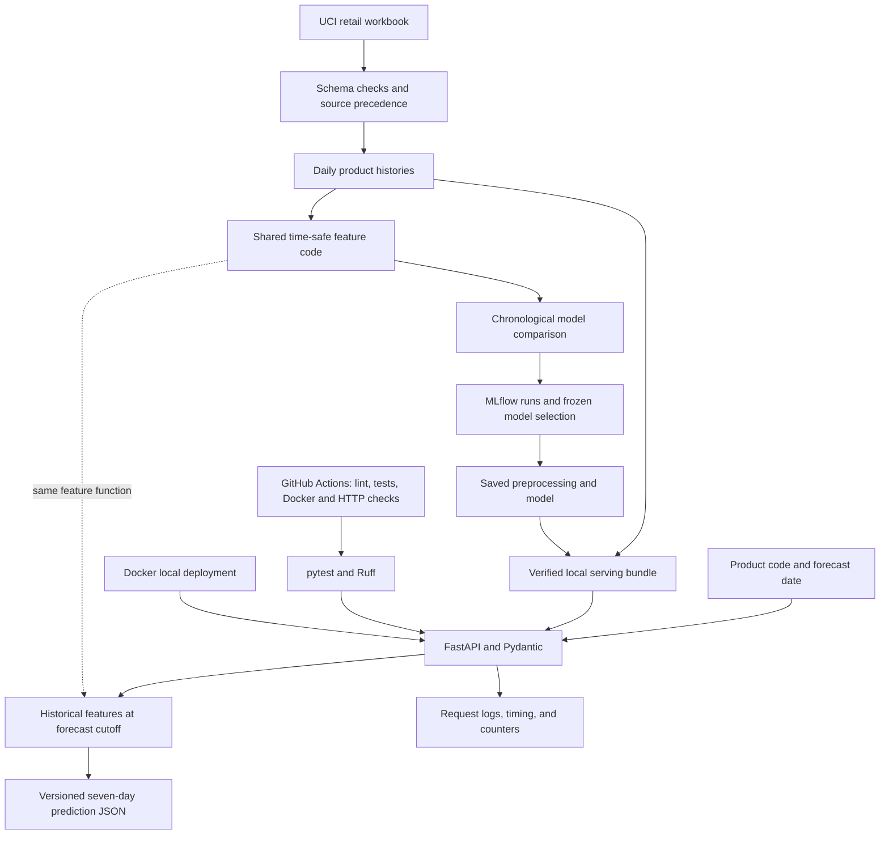
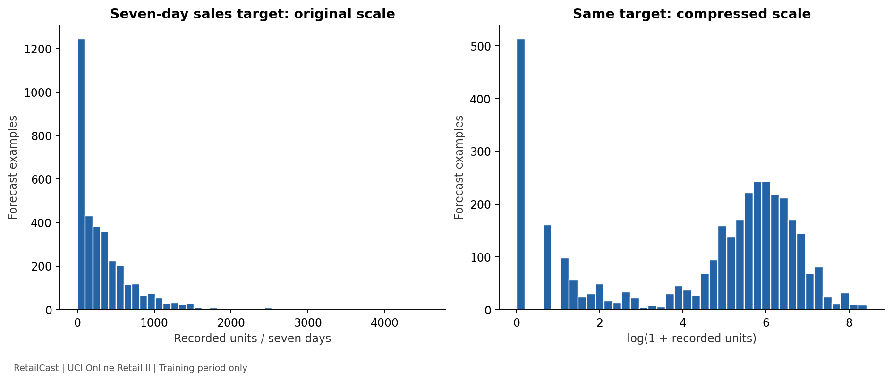
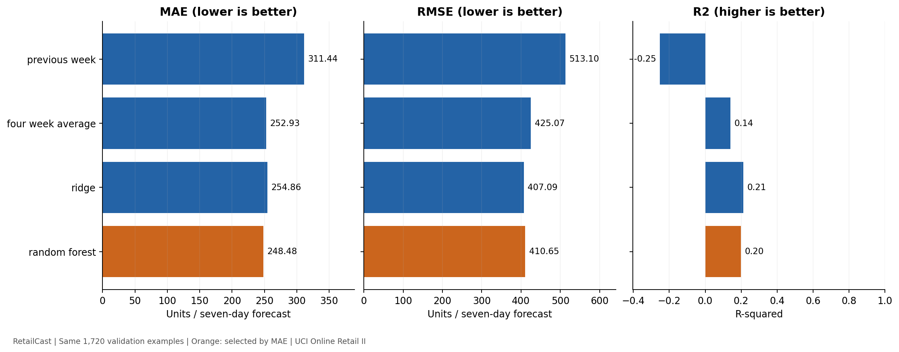

# RetailCast — Retail Sales Forecasting & Prediction API

Status: Local ML pipeline, FastAPI, Docker deployment, automated tests, and hosted
GitHub Actions are verified. The source repository is public. No cloud deployment
is claimed; local Docker is the selected deployment alternative.

[](https://github.com/nihal-usman-chenganath/retailcast-ml-engineering/actions/workflows/ci.yml)

[Repository](https://github.com/nihal-usman-chenganath/retailcast-ml-engineering) ·
[Verified hosted CI run](https://github.com/nihal-usman-chenganath/retailcast-ml-engineering/actions/runs/39309251409)

RetailCast will forecast next-seven-day recorded product sales using historical
retail transactions. A random forest has been trained and evaluated under the
protocol below. This is a learning and portfolio project; business impact and
suitability for live inventory decisions have not been established.

See [the project brief](docs/project-brief.md) for the proposed prediction task
and [the development journal](docs/development-journal.md) for verified progress.

Implementation will proceed through data inspection, preparation and EDA,
baseline modeling, MLflow tracking, FastAPI serving, tests, Docker, CI, and a
deployment decision. Each major phase produces a verified result and an
explanation of the implementation and its limitations.

## Architecture and stack



Python 3.11, Pandas/NumPy, scikit-learn, MLflow with local SQLite storage, joblib,
FastAPI/Pydantic/Uvicorn, pytest, Ruff, and Docker/Compose. PostgreSQL was not
added because this small read-only service has no transactional ingestion need.
The serving dependency file excludes MLflow and training/plotting libraries.

[Architecture PNG for sharing](reports/figures/retailcast-architecture.png) ·
[Editable SVG](reports/figures/retailcast-architecture.svg)

```text
configs/                 Dataset and training settings
scripts/                 Inspection, HTTP checks, result/architecture figures
src/data/                Preparation and EDA
src/features/            Shared historical feature calculations
src/models/              Estimators, metrics, two-stage training
src/api/                 Bundle verification and prediction service
src/monitoring/          Offline feature-distribution diagnostic
tests/                   Data, model, API, and monitoring checks
reports/                 Aggregate evidence and figures
docs/                    Decisions, tutorials, journal, posts, CV/interview drafts
.github/workflows/       Configured CI workflow
```

## Run the already prepared local service

From this repository's root in PowerShell, with Docker Desktop running:

```powershell
.\.venv\Scripts\python.exe -m src.api.bundle
docker compose up -d --build
.\.venv\Scripts\python.exe scripts/smoke_api.py --wait-seconds 60
```

Open http://127.0.0.1:8000/docs. See [Docker instructions](docs/docker.md) for
command explanations, health checks, logs, teardown, and troubleshooting.
For a fresh checkout without generated models, follow discovery, preparation,
training, and bundle generation in the sections below first.

## Run the discovery milestone (Windows PowerShell)

Open a terminal in this repository's root folder. Requires Python 3.11.

```powershell
py -3.11 -m venv .venv
.\.venv\Scripts\python.exe -m pip install -r requirements.txt
.\.venv\Scripts\python.exe scripts/inspect_data.py
```

Skip the first command if `.venv` already exists. The inspection script downloads
the original UCI archive on first use, extracts only the expected workbook, and
reads both sheets without changing their contents. Later runs reuse the local
workbook. Reading the full workbook can take several minutes.

- Raw files: `data/raw/` (excluded from Git).
- Aggregate results: `reports/data-discovery.json`.
- Workbook SHA-256: included in the report to identify the inspected file.
- Library compatibility check: `.\.venv\Scripts\python.exe -m pip check`.

Dataset source: [UCI Online Retail II](https://archive.ics.uci.edu/dataset/502/online+retail+ii).
Attribution: Chen, D. (2012), UCI Machine Learning Repository,
[DOI: 10.24432/C5CG6D](https://doi.org/10.24432/C5CG6D). UCI lists the dataset under
CC BY 4.0. Downloaded files are retained locally; no dataset is published by this
repository. The discovery report contains aggregate counts, not customer records.

The discovery command only inspects source data. The preparation command below
implements the documented cleaning and forecasting examples.

## Data preparation milestone

```powershell
.\.venv\Scripts\python.exe -m src.data.prepare
.\.venv\Scripts\python.exe -m pytest -q
```

See [data preparation decisions](docs/data-preparation.md) for the precise target,
source overlap policy, selection rules, and time-based splitting. Outputs remain
local in `data/processed/`; aggregate evidence is in
`reports/data-preparation.json`.

Verified preparation output: 20 selected products; 3,500 training examples,
1,720 validation examples, and 1,260 test examples. These are forecasting rows,
not original transaction counts. See the report
for exact date boundaries and filtering counts.

## Training-data exploration

```powershell
.\.venv\Scripts\python.exe -m src.data.eda
```

The EDA script checks source checksums, analyzes the training calendar only, and
exports six charts plus `reports/training-eda.json`. It does not open validation
or test forecasting files. EDA scope guards are included in the test suite.

Key findings: 47.02% of training product-days have zero recorded sales; the
median seven-day target is 223 units and its maximum is 4,562 units. Products
vary widely in volume, and large observations have been retained.



Read [the EDA findings](docs/training-eda.md) for all charts and limitations, and
[the baseline/evaluation protocol](docs/baseline-and-evaluation-plan.md) for the
planned model comparison. These descriptive statistics are not model accuracy.

## Model comparison and experiment tracking

All four approaches used the same 3,500 training and 1,720 validation examples.
The comparison configurations were fixed before fitting, with validation MAE
as the selection criterion.

| Candidate | Validation MAE | Validation RMSE | Validation R² |
| --- | ---: | ---: | ---: |
| Previous-week total | 311.44 | 513.10 | -0.252 |
| Four-week average | 252.93 | 425.07 | 0.141 |
| Ridge | 254.86 | 407.09 | 0.212 |
| Random forest — selected | 248.48 | 410.65 | 0.198 |

MAE and RMSE are in units per product/seven-day forecast. The forest reduced
validation MAE by **1.76%** relative to the stronger baseline, a modest gain.
Ridge had better RMSE; the declared MAE criterion determined selection.

The selected forest was refitted on 5,220 training-plus-validation examples,
then evaluated on 1,260 held-out test examples (October 1–December 2 forecast
origins, with targets ending by December 8, 2011):

| Final held-out test metric | Value |
| --- | ---: |
| MAE | 389.07 units |
| RMSE | 670.71 units |
| R² | 0.162 |

These results show limited predictive strength and uneven per-product errors.
The validation gain is not evidence of test-set superiority to the baselines,
statistical significance, stockout reduction, or financial savings. Test results
were not used to revise the model. See [results and limits](docs/model-results.md).



From a fresh prepared workspace, run:

```powershell
.\.venv\Scripts\python.exe -m src.models.train compare
.\.venv\Scripts\python.exe -m src.models.train finalize
.\.venv\Scripts\python.exe scripts/plot_model_results.py
```

Finalization creates a marker that blocks repeating model selection/test
evaluation in the same workspace. Preserve this record; use a fresh checkout to
reproduce the full process. Model files are ignored by Git and must be regenerated.

Open the local MLflow dashboard with:

```powershell
.\.venv\Scripts\python.exe -m mlflow ui --backend-store-uri sqlite:///mlflow.db --host 127.0.0.1 --port 5000
```

Visit http://127.0.0.1:5000 and select `RetailCast-sales-forecasting`.
The experiment contains four comparison runs and a final evaluation run.
Read [the MLflow guide](docs/modeling-and-mlflow.md) for comparison instructions,
artifact storage, and trust boundaries.

Final saved bundle: `models/final/model.joblib` and `metadata.json`.
Final model version (MLflow run ID): `fe48bb872b9b4d12aac4f7a5c42734e4`.
Local model files, row-level outputs, and tracking storage are excluded from Git.

Verification: **54 tests pass on Windows and Linux**, dependencies pass `pip check`, serialized models
preserve predictions, and saved test metrics reconcile with direct NumPy formulas.
The dashboard HTTP endpoint and all five finished runs/artifact listings were
also checked. A known upstream test-client deprecation warning does not prevent
the current tests from passing.

## API contract

| Endpoint | Purpose |
| --- | --- |
| `GET /health` | Model readiness and version |
| `GET /model-info` | Catalog, supported dates, target, metrics, and limitations |
| `POST /predict` | Product/date validation and seven-day forecast |
| `GET /metrics` | Process-local request, error, and timing counters |

Example PowerShell request to the container:

```powershell
$body = @{ product_id = '21212'; forecast_date = '2011-10-01' } | ConvertTo-Json
Invoke-RestMethod -Method Post -Uri 'http://127.0.0.1:8000/predict' -ContentType 'application/json' -Body $body
```

The verified model returned `predicted_units: 760.379753318479` for that request.
Responses include the model run ID and `mode: historical_replay`. This estimate
is not a measured outcome or inventory recommendation. Unknown products,
malformed requests, and unavailable dates return 422. Startup fails for missing
or corrupt bundles. Unexpected inference failures return generic 500 responses.

Supported real-bundle forecast dates are October 1–December 9, 2011. The final
date can be forecast from retained history even though its full outcome window
is not available for evaluation. See [API documentation](docs/api.md) for the
actual response JSON, native-service commands, and input/security boundaries.

## Tests, CI, and operations

```powershell
.\.venv\Scripts\python.exe -m ruff check src scripts tests
.\.venv\Scripts\python.exe -m pytest -q
.\.venv\Scripts\python.exe -m pip check
.\.venv\Scripts\python.exe -m src.monitoring.drift
```

The tests cover data rules, temporal boundaries, target/feature arithmetic,
model serialization, API health/schema/errors, tampering, inference consistency,
and monitoring diagnostics. Real-data checks also verified feature parity across
6,480 examples and Linux-container predictions across all 1,260 final test rows.

The CI workflow installs dependencies, runs lint/tests, builds a synthetic-fixture
container, and checks HTTP behavior. That fixture is clearly labelled and has no
real model performance claims. Hosted GitHub Actions passed lint, all 54 tests,
dependency checks, fixture creation, Docker build, and HTTP smoke verification.
See [the verified run](https://github.com/nihal-usman-chenganath/retailcast-ml-engineering/actions/runs/39309251409)
and [CI instructions](docs/ci-and-github.md).

Request IDs, structured logs, process counters, model versions, range flags, and
an offline feature-distribution comparison provide monitoring basics. They are
not durable production monitoring, calibrated alerts, or automatic retraining.
See [operations](docs/operations.md) and aggregate evidence in
`reports/container-api-verification.json` and `reports/feature-drift.json`.
The curated [system verification report](reports/system-verification.json)
records test counts, container controls, and cross-platform prediction parity.

## Deployment, limitations, and next improvements

Local Docker is the selected deployment. Current cloud options, resource/cost
limits, and the reason for avoiding a hosting bill are documented in
[the deployment decision](docs/deployment-decision.md). No paid account or public
cloud endpoint was created. Data/model files remain local and ignored by Git.

Limitations include old UK transactions, missing stock availability, a selected
catalog, limited forecasting accuracy, dependent overlapping target windows,
source-precedence/zero-record assumptions, and no live feed or public API auth.
The service is a historical engineering demonstration, not an inventory system
validated for business use. Future work needs new temporal evaluation, richer
available-at-cutoff signals, product-specific diagnostics, and measured business
acceptance criteria. Public exposure also requires authenticated TLS ingress,
rate/body limits, and durable monitoring.

## Portfolio and learning evidence

- [Development journal](docs/development-journal.md)
- [LinkedIn introduction/discovery](docs/data-discovery.md),
  [preparation](docs/linkedin-data-preparation.md), [EDA](docs/linkedin-eda.md),
  [modeling](docs/linkedin-modeling.md), and [serving/delivery/final drafts](docs/linkedin-serving-and-delivery.md)
- [Role-specific CV and profile descriptions](docs/career-portfolio.md)
- [Interview walkthrough and practical self-checks](docs/interview-preparation.md)
- [Release status and remaining gates](docs/completion-status.md)

All posts are drafts, not published messages. The journal records coding-assistant
support; understanding of the complete system remains a learner self-check.
