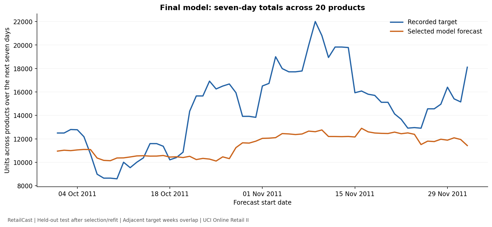
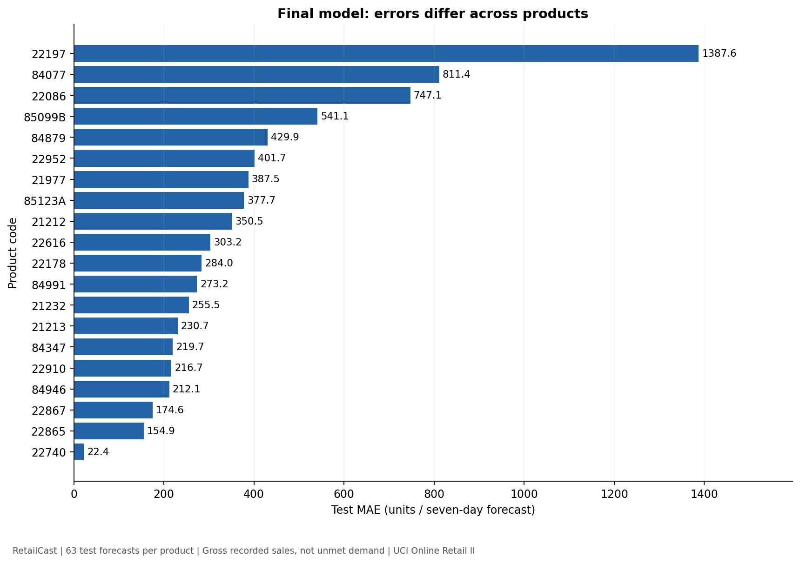

# Actual model results and limitations

Evidence: `reports/model-comparison.json`, `reports/final-evaluation.json`, and
the local MLflow experiment `RetailCast-sales-forecasting`.

## Validation comparison

| Model | Training MAE | Validation MAE | Validation RMSE | Validation R² |
| --- | ---: | ---: | ---: | ---: |
| Previous-week total | 280.14 | 311.44 | 513.10 | -0.252 |
| Four-week average | 234.74 | 252.93 | 425.07 | 0.141 |
| Ridge | 204.48 | 254.86 | 407.09 | 0.212 |
| Random forest | 144.15 | 248.48 | 410.65 | 0.198 |

The forest wins under the predeclared validation-MAE criterion. Its improvement
over the stronger four-week baseline is 4.45 units per forecast, or 1.7575%.
This is a modest validation difference. We have not established statistical
significance, particularly with overlapping seven-day targets.

Ridge has lower validation RMSE and higher R² than the forest. That does not
change selection: using a different metric after seeing the results would change
the recorded protocol. The forest's training score is much better than its
validation score; training error is not an estimate of future accuracy.

The forest also costs more than either arithmetic baseline. On this local run,
its fit took about 1.92 seconds versus 0.004 seconds for the baselines. Predicting
the full 1,720-row validation batch took about 0.027 seconds versus roughly
0.003 seconds. These are single-run timings, not controlled latency benchmarks
or API response-time guarantees. The final serialized model is 3,842,190 bytes.

## Final held-out evaluation

Frozen comparison run: `c13c6e0868d840f79affd1c661f165f5`.
Final model/evaluation run: `fe48bb872b9b4d12aac4f7a5c42734e4`.

The selected forest was refitted on 5,220 development examples (training plus
validation). It was then evaluated on the reserved 1,260 test examples:

- MAE: **389.070958** units per product/seven-day forecast.
- RMSE: **670.709348** units.
- R²: **0.161548**.

Each product has 63 test forecast origins. Performance varies widely: product
22197 has an MAE of about 1,387.6 units. A pooled score is insufficient for
deciding whether any individual product forecast is useful.

The aggregate forecast chart shows underestimation over much of the later test
period. This is a post-evaluation diagnosis, not a basis for retuning against
the same test set. A future experiment would need a new evaluation design/data
before any revised model could receive an unbiased final assessment.

## What the results do and do not establish

- A working reproducible model-selection and serialization workflow exists.
- The forest achieved the lowest validation MAE among four fixed candidates.
- Forecast accuracy is limited. No minimum business acceptance threshold has
  been validated, and this model is not approved for live inventory decisions.
- Only the selected final model was evaluated on test. We do not claim that it
  beat the baselines on test or reduced error by 1.76% on test.
- Historical UK sales and selected established products are the evaluated scope.
  No UAE-specific performance or cold-start performance is established.
- Sales do not reveal unmet demand or inventory availability. Business savings,
  reduced waste, and stockout prevention were not measured.

## Verification completed

All 32 tests passed and `pip check` found no broken requirements. Saved/reloaded
candidate and final model predictions matched. Direct NumPy MAE, RMSE, and R²
calculations on the saved test predictions matched the reported metrics.

The local MLflow dashboard returned HTTP 200. Its HTTP API confirmed five
finished runs and model/evaluation artifact listings. The final model checksum
matched its metadata. Charts were rendered and visually inspected.

The MLflow server reports that its job-execution backend is unsupported on
Windows; this workflow uses local Python training and experiment tracking, not
that backend. The dashboard and tracking checks passed. An upstream WSGI
deprecation warning also appeared at dashboard startup without preventing use.

Automatic approval review blocked launching Edge for a dashboard screenshot,
stating "blocked by policy". No dashboard screenshot was captured; the figures
above are genuine plots of recorded results, not dashboard mockups.
