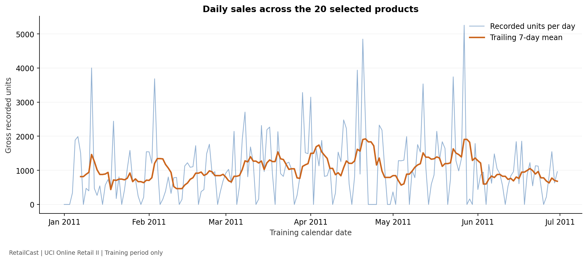
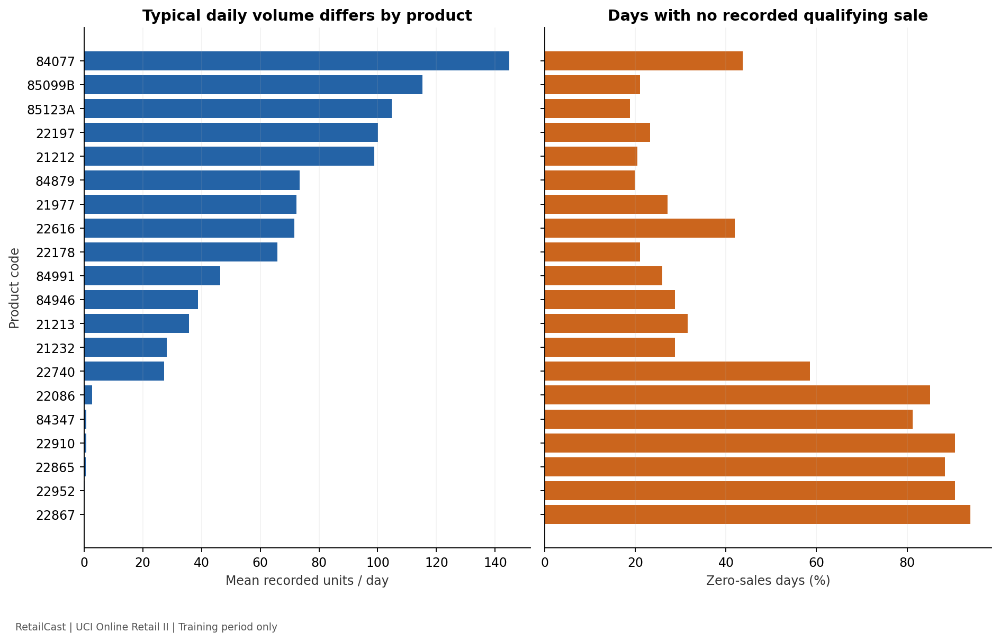
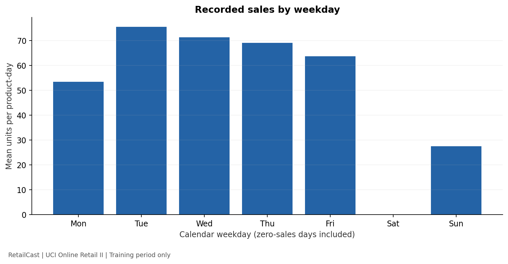
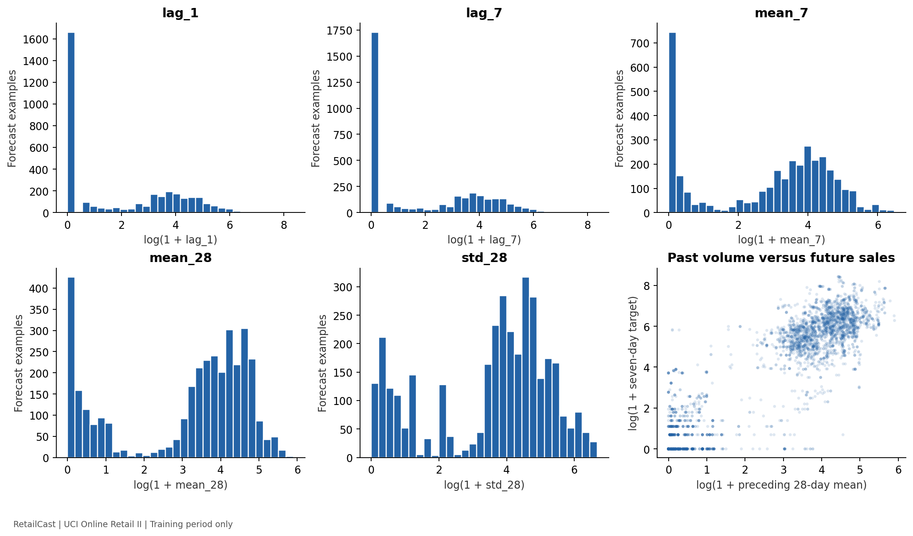
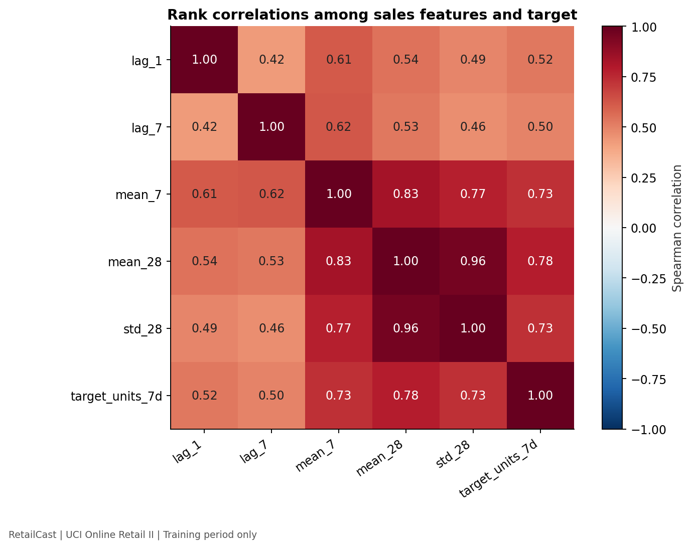

# Training-data exploration

Scope: 20 selected products, January 1–June 30, 2011 daily records and 3,500
training forecast examples. No validation or test outcomes were analyzed.
The daily panel includes June 25–30 because those days supply the final training
targets; training forecast origins stop on June 24.

Reproduce with `python -m src.data.eda` using the project virtual environment.
The script verifies input checksums against the preparation report and writes
`reports/training-eda.json` and six PNG figures. It reads `train.csv` and the daily
panel; daily records outside the training calendar are filtered out before
analysis. It does not open validation/test example files.

## Findings and their implications

| Measured training statistic | Value |
| --- | ---: |
| Product-day rows | 3,620 |
| Total qualifying recorded units | 186,223 |
| Product-days with zero recorded sales | 47.02% |
| Seven-day targets equal to zero | 514 of 3,500 (14.69%) |
| Median seven-day target | 223 units |
| 95th percentile seven-day target | 1,269.20 units |
| Largest seven-day target | 4,562 units |
| Largest single-product/day observation | 4,314 units |
| Missing values in prepared training examples | 0 |

1. **The target has a long upper tail.** Large orders can dominate squared
   errors. Use MAE as the primary comparison metric and RMSE to expose large
   misses. We have not removed or capped large observations. IQR flags are
   diagnostic labels, not proof of bad data.
2. **Zero recorded sales are common.** Avoid MAPE as the primary metric; zero
   targets make ordinary percentage errors undefined. A zero is not evidence of
   zero customer interest or stock availability.
3. **Volume differs strongly across products.** Mean daily sales range from
   about 0.10 to 144.80 units. Some products selected for their pre-2011 activity
   have little subsequent training-period activity. This may reflect seasonality,
   catalog changes, availability, or other factors we cannot identify here.
   Keep the selection fixed rather than quietly removing difficult products.
4. **The selected set has no recorded Saturday sales during training.** Average
   recorded units per product-day range from 0 on Saturdays to about 75.57 on
   Tuesdays. This does not prove a retailer operating calendar. A complete
   seven-day target always contains every weekday once, so daily weekday
   differences do not automatically imply a strong weekday effect on weekly
   totals. Models must establish any value from the calendar features.
5. **Historical volume is associated with the target.** Spearman correlations
   are about 0.73 for `mean_7` and 0.78 for `mean_28`. These are pooled training
   associations, partly reflecting differences between products and overlapping
   historical/target windows across rows. They do not establish causality or
   predict which forecast will perform better on validation data.

Logarithms in charts compress the scale so small and large values are both
visible. They are visualization choices, not an implemented model transformation.
IDs are treated as labels; numerical correlations exclude product IDs and
arbitrary numeric weekday/month encodings.

## Charts

## Baseline decision

Record two simple forecasts before fitting models: the previous seven-day total
and seven times the preceding 28-day daily average. Their trade-offs and the
frozen comparison protocol are in `baseline-and-evaluation-plan.md`.
No forecasts have been evaluated and no predictive accuracy is claimed in EDA.

## Learning example

Suppose a product sells 4,000 units on one unusual day. A previous-week-total
baseline will repeat that week's high volume. A four-week-average forecast
spreads the spike over a longer history but may react more slowly to real growth.
The validation experiment, not training correlation, decides which works better.
